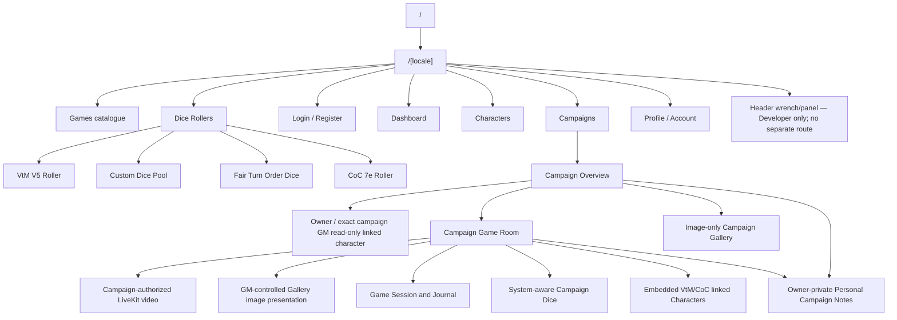

# Site Map

## Status

This document separates the current implemented route map from approved forward product areas. Planned labels are not routes until implementation exists.

## Current implemented site map

The catalogue includes a generic CoC 7e campaign shell and the deployed Phase 4D1 CoC personal dice route with contextual navigation, scoped history, and live Target bands. VtM/CoC characters use owner-private Character Library routes; only the exact eligible active campaign GM additionally receives read-only linked sheet/portrait access. Delta Green is a catalogue entry only. No complete game-system hub exists.

## Completed Phase 4

Phase 4E Fair Turn Order Dice, 4F1 CoC sheets, 4F2 linked Game Room Characters and 4G owner-private Personal Campaign Notes are CLOSED / DEPLOYED / ACCEPTED. Notes is available from Overview and Game Room with search/session metadata; it has no sharing, rich text or Realtime.

Phase 4E delivered the standalone, system-neutral Fair Turn Order Dice route under the existing Dice Rollers hub. It implements the published Go First Dice mathematical model and does not add Campaign Dice, Game Room, persistence, or account behavior. Unavailable campaign placeholders must remain visibly disabled and must not expose fake routes or behavior.

Campaign Gallery contains four fixed image-only sections: Handouts, NPC, Maps & Plans, and Other. NPC and Maps & Plans are image categories, not structured systems. Phase 4C2 added presentation, not a general document Handouts feature. Notes do not imply Sessions, Chronicle, NPC records, clues, structured maps, or wiki modules.

GM Computer Audio Sharing and Developer Diagnostics are deployed; manual multi-user acceptance is postponed to a gaming session. The successful single-GM diagnostics ZIP is not distributed acceptance. These add-ons do not block Phase 5A planning.

## Later approved areas

- Phase 5A Campaign and Game Room UX/UI Refinement — PLANNED / NOT STARTED, no new capabilities/routes;
- Phase 5B site-wide UI Technical Refinement — PLANNED / NOT STARTED, no new capabilities/routes;
- Phase 6 Visual Identity adds no product routes by itself;
- Phase 7 implements Delta Green parity using established shared routes and system-specific routes justified at implementation time;
- Phase 8 adds system hubs in CoC, Delta Green, then Vampire order;
- Phase 9 may add public-readiness support routes only after their exact operational need is reviewed.

## Explicit non-routes

Standalone Video Rooms are not active roadmap scope. `/[locale]/video-rooms` and related routes are not approved targets. Global/document Handouts, NPCs, Sessions, Chronicle, recording, transcription, and screen-sharing routes are also not active commitments.

## Current versus planned

| Area | Current | Approved forward state |
|---|---|---|
| Campaign video | Implemented and Production accepted | Retain; technical refinement only unless separately scoped |
| Campaign Gallery | Four-section private image library and Game Room presentation implemented | Retain; Campaign Wallpaper remains uncommitted `IDEA-007` only |
| VtM dice | Personal and Campaign Dice implemented | Retain; direct Game Room roller with no submenu |
| CoC dice | Personal and Campaign Dice implemented | Retain; Game Room defaults to Percentile with its internal submenu |
| Fair Turn Order Dice | Standalone local tool closed/deployed/accepted | Retain as a system-neutral, non-persistent implementation of the Go First Dice model |
| VtM characters | Sheets and linked Game Room integration accepted | Retain |
| CoC characters | Sheets and linked Game Room integration accepted | Retain |
| Campaign notes | Owner-private Notes implemented/accepted | Retain; Global Notes IDEA-008 deferred |
| Game-system hubs | Not implemented | 8A CoC, 8B Delta Green, 8C Vampire |
| Standalone Video Rooms | Not implemented | Uncommitted backlog idea only |
